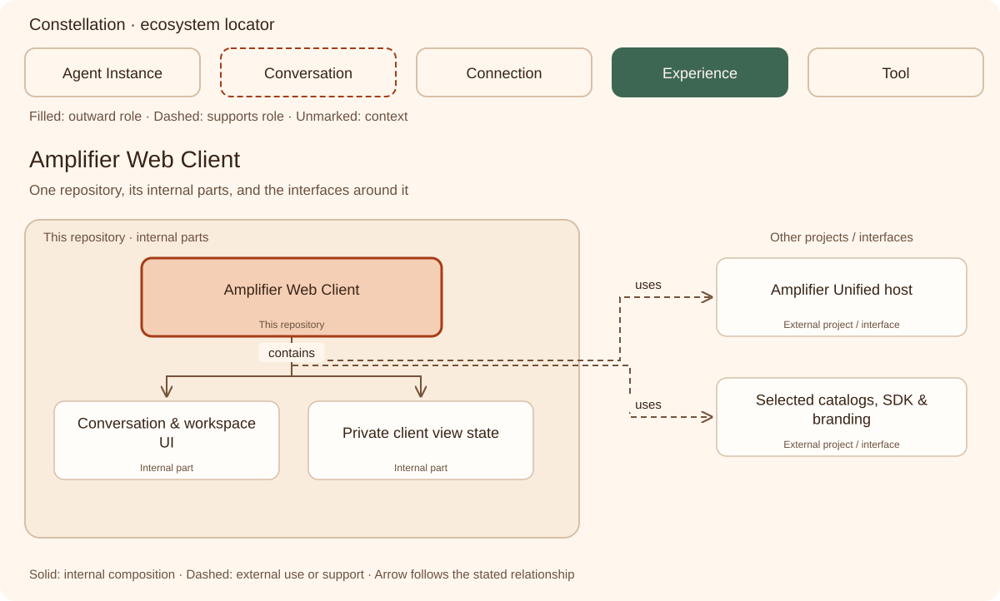

# Amplifier Web Client

The browser interface for [Amplifier Unified](https://github.com/microsoft/amplifier-unified):
conversations, workspaces, tool activity, and interactive work surfaces. The client
connects to a Unified host over HTTP, server-sent events, and WebSockets; the host
runs agents and stores conversation history.

**To use Amplifier, install [Unified](https://github.com/microsoft/amplifier-unified#readme).**
This repository is for developers working on its web client. Source changes here
do not automatically update a Unified installation.

## Get started

Use Node.js 22. Clone this repository, then install dependencies and prepare the
shared catalogs, SDK, and branding selected by `build-inputs.lock.json`:

```sh
git clone https://github.com/microsoft/amplifier-client-web.git
cd amplifier-client-web
npm ci
npm run prepare:inputs
```

Input preparation fetches the pinned public files and verifies their hashes.
For offline work, use `npm run prepare:inputs -- /path/to/canonical-export` with
the exact locked export.

Run a compatible [Unified development host](https://github.com/microsoft/amplifier-unified/blob/main/CONTRIBUTING.md)
on port 8765, then start the client:

```sh
npm run dev
```

Open the local address printed by Vite. API and WebSocket requests are proxied to
the development host. This client does not install or start the agent backend.

## Suggested messages

On a host that supports app-level suggestions, Settings → Chat & input has one
everyday **Show suggested messages** switch and the Enter / Return preference.
Suggestions are off by default. The choice is synced in this authenticated
installation owner's saved settings across clients, reloads and sign-ins.
It is not a cloud or cross-host account preference. Old browser choices are
not migrated or promoted into the synced setting.
The suggestion provider/account and model are shown separately from the chat model.
The same feature's **Advanced settings** holds explicit host setup across workspaces,
model/effort choices, expert recent/full text sharing and a deeper custom instruction.
Global Advanced and Privacy link to this one feature destination rather than owning
duplicate editors. If host setup is missing, **Set up suggested messages** opens a
compact **Save setup and enable** confirmation; opening it alone changes neither
host settings nor your choice.
Host-setup success and a failed synced-preference save are reported separately.
Preference saves use a setting-specific revision so another client's newer Off
choice wins over a delayed setup-and-enable operation.
Setup/model/instruction saves also carry the displayed suggestion-configuration
revision. A concurrent sharing/account change rejects the save atomically,
keeps staged edits and refreshes current setup for explicit review—never a
silent Recent-to-Full change or an automatic mutation retry. A failed setup read
has a read-only retry and can recover on a fresh connection; neither runs a
suggestion or discovers models.
There is no automatic model selection or fallback; a configured connection is
not a claim that every provider or model supports this feature.
The saved connection/model card has a **Change** action. Optional recommendations
come from the selected module's purpose ranking for that exact catalog, with its
live/configured/static provenance; an unknown module is never guessed from its
name or model-family substrings. Manual model IDs stay in Advanced. A newer
recommendation does not replace a saved explicit choice or sharing consent.

The host sends bounded visible conversation text to the selected provider,
including other participants' messages—not an agent's private context or an
unsent draft. The client requests a suggestion only by conversation and committed
message identifiers. The selected chat can request once when idle with an empty
message box while the page is visible and focused, including when you visit an
existing chat. No other chat or background page requests work. A source-bound
READY response can remain in bounded private memory while its source and settings
are unchanged; revisits still validate the original attempt without model work.
Finite responses obey their original expiry. Failed, empty, cancelled or missing
attempts do not trigger a client retry loop. Suggestions are automatic; there is no
creation or regeneration control. Closing Settings after confirmed enable checks
the already-viewed eligible chat immediately. The composer shows **Loading a
suggested message…**, **No suggestion this time**, or a safe unavailable/failure
explanation with setup review—not a chat-working badge. Returning to a retained
non-ready attempt reads its exact original ID, without a new inference request.
If an admission acknowledgement is lost or malformed, the client withdraws that
exact possibly-admitted attempt once rather than treating an HTTP abort as
provider cancellation. Late output cannot restore preview authority; returning
still reconciles the original receipt. Withdrawal does not undo provider effects.
Reopening or reloading an eligible conversation
can ask the host for its current source-bound result, including a cached empty
outcome, without duplicate model work. The host owns durable private suggestion
storage; ghosts are never stored as drafts or in a second persistent browser cache.
Starting a new chat before it has a response makes no request. In suggested-message
Advanced settings, restoring the default instruction stages an edit requiring Save;
the actual sharing modes remain recent conversation or full visible conversation.
Advanced model details (pricing, catalog origin and refresh time) stay in a
secondary disclosure; ordinary connection/model controls remain readable.

Writing offers Automatic with its actual platform outcome, explicit **Send
message**, or **Start a new line**. Existing Automatic/newline preferences and
the conservative touch default are preserved. Explicit Send uses the same
guarded Enter handler; Shift+Enter continues writing and IME confirmation does
not send. The keyboard preference remains browser-local, separate from the
synced suggestion setting and from appearance profiles.

The private preview is not part of the editor document. Tab in the focused empty
editor, or **Use suggestion**, adds literal, editable, undoable text; sending is
always a separate action. Typing or pasting hides the placeholder. Clearing the
message box, including Undo after acceptance, can restore the same valid
suggestion after a status-only check, without another model call. Escape dismisses
it for that source; Stop, attachments, quotes and source/configuration changes
invalidate it. Explicit desktop chat selection focuses an editable composer once
after navigation commits, unless newer user interaction or a blocked surface
takes priority. Touch-capable environments do not automatically focus it. The mounted browser check
`node tests/transcript-suggestion-mounted-browser.mjs` uses synthetic action
responses. It does not qualify a provider, installed host, or LAN deployment.

## Check and build

```sh
npm test
npm run build
npm run test:artifact-assets
```

The build writes `dist/`. See [package.json](package.json) for focused checks and
[AGENTS.md](AGENTS.md) for source, test, and packaging guidance.

## Unified delivery

This repository owns the browser source. Unified selects an exact accepted public
revision and production-input digest through its
[documented selection workflow](https://github.com/microsoft/amplifier-unified/blob/main/components/README.md#select-public-client-source).
It prepares that source, qualifies the client/server pairing and ships complete
built assets. Installing a released Unified wheel or source distribution does not
require Node or this checkout.

Author changes here first. A client source merge or release does not automatically
update Unified: carry intended changes through selection and release or make a
named integration handoff with exact revisions and pending work.

For interface and design work, use the pinned
[client vision](https://github.com/microsoft/amplifier-unified/blob/816c7a67dbafc20bfb28723dd317c71d3bd2bb28/docs/clients/VISION.md) and
[client development contract](https://github.com/microsoft/amplifier-unified/blob/816c7a67dbafc20bfb28723dd317c71d3bd2bb28/contracts/client-development.v1.md).

See [support](SUPPORT.md), [security reporting](SECURITY.md), and the [MIT license](LICENSE).


<!-- ecosystem-map:start -->
## Where this fits

The selected browser frontend for the current Amplifier Unified application.

Roles: Experience. Supports: Conversation.



[Product page](https://microsoft.github.io/amplifier-constellation/projects/amplifier-client-web/) · [Open the map](docs/ecosystem-map.svg) · [Map guide](https://github.com/microsoft/amplifier-constellation/blob/main/docs/ecosystem-maps.md)

<details>
<summary>The five shared building blocks</summary>

[](https://microsoft.github.io/amplifier-constellation/)

</details>

<!-- ecosystem-map:end -->

## Contributing

Most contributions require you to agree to a
Contributor License Agreement (CLA) declaring that you have the right to, and actually do, grant us
the rights to use your contribution. For details, visit [Contributor License Agreements](https://cla.opensource.microsoft.com).

When you submit a pull request, a CLA bot will automatically determine whether you need to provide
a CLA and decorate the PR appropriately (e.g., status check, comment). Simply follow the instructions
provided by the bot. You will only need to do this once across all repos using our CLA.

This project has adopted the [Microsoft Open Source Code of Conduct](https://opensource.microsoft.com/codeofconduct/).
For more information see the [Code of Conduct FAQ](https://opensource.microsoft.com/codeofconduct/faq/) or
contact [opencode@microsoft.com](mailto:opencode@microsoft.com) with any additional questions or comments.

## Trademarks

This project may contain trademarks or logos for projects, products, or services. Authorized use of Microsoft
trademarks or logos is subject to and must follow
[Microsoft's Trademark & Brand Guidelines](https://www.microsoft.com/legal/intellectualproperty/trademarks/usage/general).
Use of Microsoft trademarks or logos in modified versions of this project must not cause confusion or imply Microsoft sponsorship.
Any use of third-party trademarks or logos are subject to those third-party's policies.
